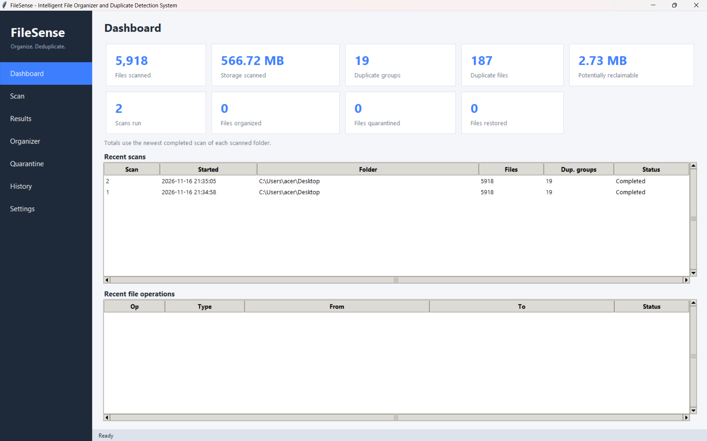
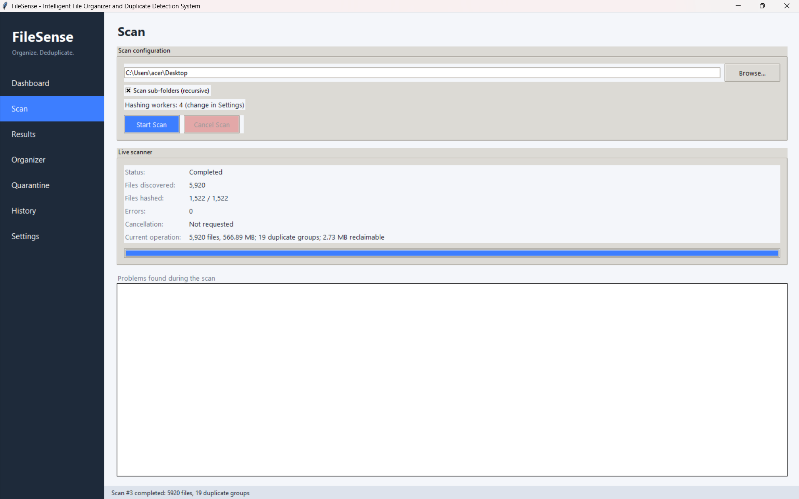
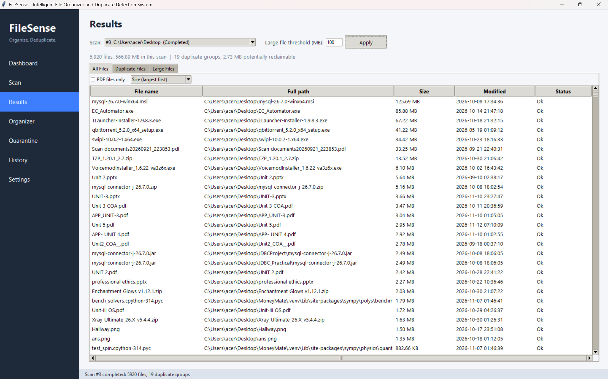
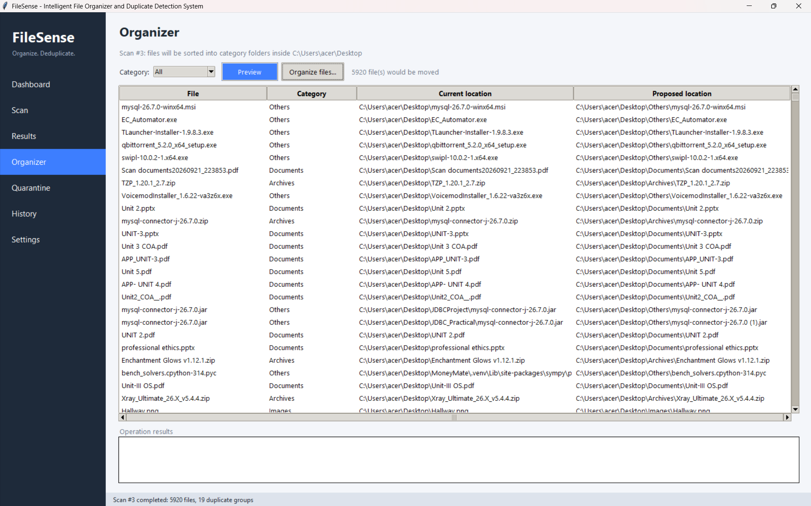
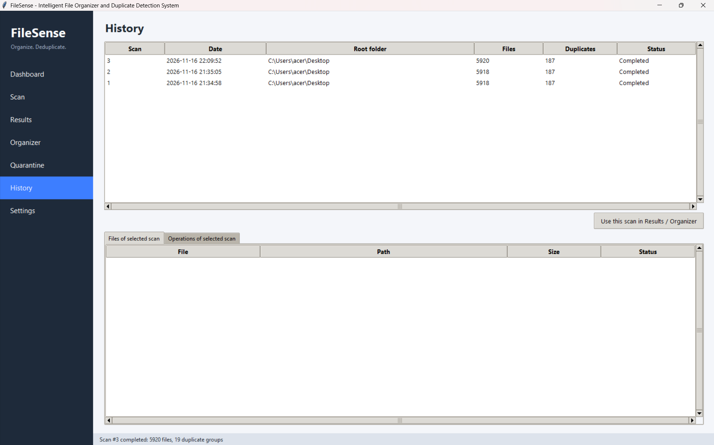
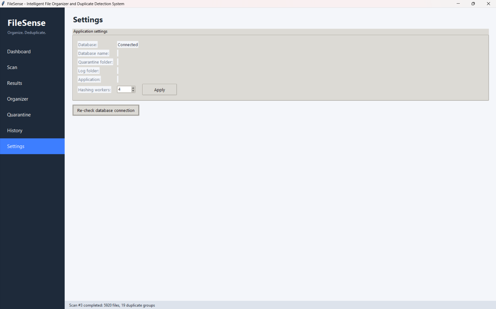
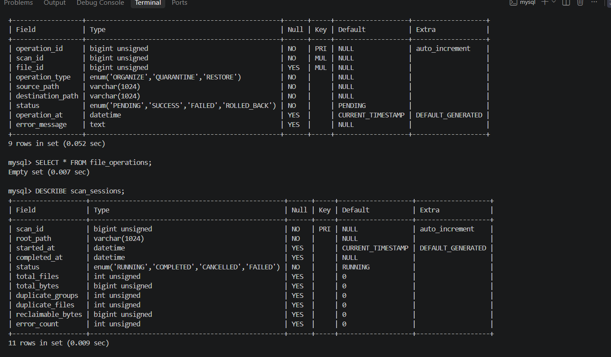

# FileSense – Intelligent File Organizer and Duplicate Detection System

FileSense is a Python desktop application that scans folders you choose, finds **exact duplicate files** using
SHA-256, sorts files into category folders, and moves unwanted duplicates to a **reversible quarantine**
(nothing is ever permanently deleted). Scans, file metadata and every file operation are stored in **MySQL**.

---

## 1. Screenshots

> Save your screenshots in `docs/screenshots/` using exactly these file names and they will appear below.

### Dashboard


### Scan configuration and live scanner


### Results – duplicate files


### Organizer – preview before moving


### History


### Settings


### MySQL tables (data stored in the database)


---

## 2. Problem statement
Downloads, Documents and Desktop folders fill up with copies of the same file, unsorted files, wasted storage and
no record of what was moved. FileSense automates scanning, duplicate detection, categorisation and safe cleanup.

## 3. Objectives
1. Scan user-selected folders  2. Collect file metadata  3. Compute SHA-256 hashes  4. Detect duplicate groups
5. Calculate reclaimable storage  6. Organise files by extension  7. Quarantine duplicates  8. Restore them
9. Keep operation history in MySQL  10. Show statistics in the GUI

## 4. Features
- Recursive scan with live progress and a Cancel button
- Duplicate detection by size first, then SHA-256 (names are never compared)
- Duplicate groups with potentially reclaimable space
- Result views: All files, Duplicate files, Large files
- Organise files with **preview and confirmation**; existing files are never overwritten
- Quarantine and restore (restore never overwrites an existing file)
- Scan and operation history; dashboard built from real database data
- Settings page (connection status, hashing workers, folders)

## 5. Technology stack
| Purpose | Technology |
|---|---|
| Language | Python 3 |
| GUI | Tkinter / ttk |
| Database | MySQL with `mysql-connector-python` (only external dependency) |
| Hashing | `hashlib` (SHA-256) |
| Scanning | `os.scandir` |
| Concurrency | `threading`, `ThreadPoolExecutor`, `queue.Queue`, `threading.Event` |
| Functional programming | `lambda`, `filter()`, `functools.reduce()` |
| Logging / testing | `logging`, `unittest` |

No sockets, no web framework, no other database.

## 6. Architecture (three layers)
| Layer | Folders | Responsibility |
|---|---|---|
| Presentation | `ui/` | Tkinter screens only – no SQL, no file scanning |
| Business logic | `scanner/`, `organizer/`, `analytics/` | Scanning, hashing, duplicates, organise, quarantine, analytics |
| Data access | `database/` | Connections and repositories – all SQL lives here |

`utils/` holds formatting, logging and the event/progress classes shared by the layers.

## 7. Folder structure
```
FileSense/
├── main.py  config.py  requirements.txt  README.md  VIVA_GUIDE.md
├── ui/         app, dashboard, scan_page, results_page, organizer_page,
│               quarantine_page, history_page, settings_page
├── scanner/    discovery, hashing, duplicate_finder, scan_manager
├── organizer/  file_categories, organizer, quarantine
├── database/   connection, repository, schema.sql
├── analytics/  analytics
├── utils/      formatting, logger, progress
├── tests/      unit tests + optional database integration test
├── docs/screenshots/   screenshots used in this README
└── storage/quarantine/
```

## 8. Database schema (`filesense_db`, three tables)
- **scan_sessions** – one row per scan: `scan_id` (PK), root folder, start/end time, status, totals, duplicate statistics.
- **scanned_files** – one row per file per scan: `file_id` (PK), `scan_id` (FK), path, name, extension, size, modified time, `sha256`, `scan_status`.
  Indexes on `(scan_id, size_bytes)` and `(scan_id, sha256)`.
- **file_operations** – ORGANIZE / QUARANTINE / RESTORE history: `operation_id` (PK), `scan_id` (FK), `file_id` (FK, `ON DELETE SET NULL`), source, destination, status, error message.

```
scan_sessions ──1:N──> scanned_files ──1:N──> file_operations
      └────────────────────1:N─────────────────────^   (file_operations.scan_id as well)
```
A primary key identifies a row. A foreign key points to another table's primary key and may repeat, because one scan has many files.
File **contents** are never stored – only metadata.

## 9. Multithreading
```
Tkinter main thread ── start_scan() ──> Coordinator thread ──> ThreadPoolExecutor (Hash Worker 1..N)
        ^                                   │ discovery, MySQL writes, duplicate grouping
        └──── root.after() polls ──── queue.Queue (events) <──┘
```
- **Main thread** – draws widgets and polls the queue every 100 ms, so the window never freezes.
- **Coordinator thread** – discovery, schedules hashing, collects results, writes to MySQL, publishes events.
- **Worker threads** – only open files and compute SHA-256 (no Tkinter, no MySQL).
- **Cancel** – a `threading.Event`: queued tasks are cancelled, running ones stop at the next chunk, results so far are saved and the scan is marked `CANCELLED`.
- **Events** (documented in `utils/progress.py`): `SCAN_STARTED`, `DISCOVERY_PROGRESS`, `HASH_PROGRESS`, `SCAN_COMPLETED`, `SCAN_CANCELLED`, `SCAN_FAILED`, `ERROR`.

## 10. How duplicates are detected
1. Group files by size → 2. ignore sizes that occur once → 3. SHA-256 only the remaining files (read in 1 MB chunks) →
4. group by `(size_bytes, sha256)` → 5. groups with two or more files are duplicates.

Reclaimable space = `(copies − 1) × file size`. A file that changes while it is being hashed is marked `CHANGED` and ignored.

## 11. lambda, filter and reduce (in `analytics/analytics.py`)
- `reduce` – `total_size()`, `total_reclaimable()` and the dashboard totals
- `filter` – `filter_pdfs()`, `filter_large()`, `filter_duplicates()`, `filter_by_category()`
- `lambda` – sort keys in `sort_by_size()`, `sort_by_name()`, `sort_groups_by_reclaimable()`

## 12. Installation (Windows CMD)
Install **Python 3** from python.org (tick **Add python.exe to PATH**) and **MySQL Community Server**. Then, in CMD,
type each command on its own line:

```bat
cd /d "C:\path\to\FileSense"
python -m venv venv
venv\Scripts\activate
pip install -r requirements.txt
```

## 13. MySQL setup (once)
Create the database and tables with `schema.sql`. Use the full path to `mysql.exe` if `mysql` is not recognised
(adjust the version folder to match your installation):

```bat
"C:\Program Files\MySQL\MySQL Server 8.0\bin\mysql.exe" -u root -p < database\schema.sql
```

Or open `database/schema.sql` in **MySQL Workbench** and run it. `schema.sql` is safe to run more than once.
Check the result:

```bat
"C:\Program Files\MySQL\MySQL Server 8.0\bin\mysql.exe" -u root -p -e "USE filesense_db; SHOW TABLES;"
```
Expected tables: `file_operations`, `scan_sessions`, `scanned_files`.

## 14. Configuration (no passwords in the code)
Credentials come from environment variables, set in the same CMD window before starting the app:

```bat
set FILESENSE_DB_USER=root
set FILESENSE_DB_PASSWORD=your_password
```
Optional: `FILESENSE_DB_HOST` (default `localhost`), `FILESENSE_DB_PORT` (`3306`), `FILESENSE_DB_NAME` (`filesense_db`),
`FILESENSE_HASH_WORKERS` (`4`). Never commit passwords to GitHub.

## 15. Run the application
```bat
cd /d "C:\path\to\FileSense"
venv\Scripts\activate
set FILESENSE_DB_USER=root
set FILESENSE_DB_PASSWORD=your_password
python main.py
```
Optional `run.bat` (asks for the password each time, so it is not stored in the file):
```bat
@echo off
cd /d "%~dp0"
set FILESENSE_DB_USER=root
set /p FILESENSE_DB_PASSWORD=Enter MySQL root password: 
if exist venv\Scripts\python.exe (
    venv\Scripts\python.exe main.py
) else (
    python main.py
)
pause
```

**Using the app:** Scan (choose folder → Start) → Results (duplicates, quarantine) → Organizer (preview, confirm) →
Quarantine (restore) → History and Settings.

## 16. Run the tests
```bat
python -m unittest discover -s tests -t .
```
Unit tests use temporary folders and in-memory fake repositories, so they touch neither your files nor MySQL.
Optional real-database tests (use an **empty test database**, never the real one):
```bat
set FILESENSE_TEST_DB=filesense_test_db
python -m unittest tests.test_database_integration
```

## 17. Viewing the stored data (MySQL)
```sql
USE filesense_db;
SELECT * FROM scan_sessions;
SELECT file_id, scan_id, file_name, size_bytes, LEFT(sha256,12) AS hash_start, scan_status FROM scanned_files;
SELECT operation_id, operation_type, status, source_path, destination_path FROM file_operations;
```
End a query with `\G` instead of `;` to print rows vertically.

## 18. Safety rules implemented
Only the chosen folder is scanned · symbolic links are not followed · the quarantine folder is excluded ·
scanning never modifies files · organising needs preview and confirmation · existing files are never overwritten
(`name (1).ext`) · duplicates are moved, never deleted · at least one copy per group must stay ·
operations are logged PENDING → SUCCESS/FAILED · interrupted operations and scans are reconciled at startup ·
parameterized SQL only.

## 19. Troubleshooting
| Message | Fix |
|---|---|
| `The system cannot find the path specified` | Run `cd /d "..."` on its own line, then `dir`; you should see `main.py` |
| `Python was not found` | Install Python with *Add to PATH*, open a **new** CMD window |
| `mysql-connector-python is not installed` | Activate the venv, then `pip install -r requirements.txt` |
| `Access denied` | Wrong MySQL password – set `FILESENSE_DB_PASSWORD` again (no quotes) |
| `MySQL unavailable` | Start the **MySQL** service in Windows Services |
| `Database not found` | Run `schema.sql` once (section 13) |

## 20. Limitations and future work
Organise and quarantine run on the GUI thread (fast for same-drive moves, but a very large cross-drive move could
freeze the window briefly) · `scanned_files` keeps the path from scan time (moves are tracked in `file_operations`) ·
no scheduled scans · no near-duplicate or image-similarity detection. Possible additions: a background move
worker, undo for organise, CSV export.
